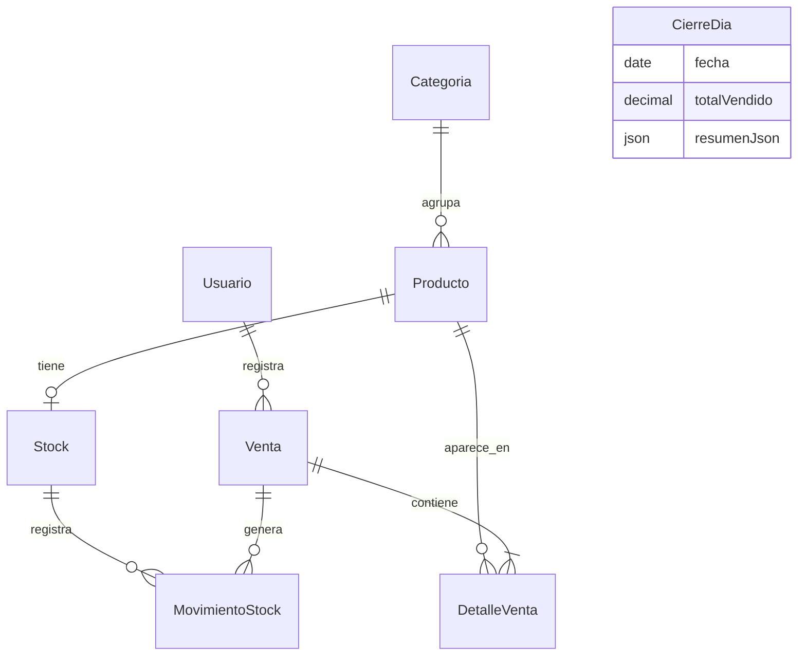

<div align="center">

# Sistema de Gestión para Rotisería

**Ventas, stock y cierre de caja para un comercio gastronómico real, en una sola aplicación web.**


</div>

> [!NOTE]
> **La demo en vivo está fuera de línea.** El backend estaba desplegado en el plan gratuito de Railway, que venció. El frontend sigue publicado en Vercel, pero sin la API no puede iniciar sesión. Para probar el sistema, seguí los pasos de [Cómo correrlo localmente](#cómo-correrlo-localmente).

---

## Contexto

Proyecto desarrollado **de forma individual para un cliente real**: una rotisería que llevaba ventas y stock a mano. Trabajé por entregas: el cliente validaba cada una contra sus necesidades y a partir de eso se definía la siguiente.

El objetivo era resolver tres problemas concretos del día a día:

- Saber **cuánto se vendió y por qué medio de pago** sin sumar tickets a mano.
- Enterarse **antes** de que un producto se quede sin stock.
- Hacer el **cierre de caja** al final del día en un clic.

## Funcionalidades

| Módulo                     | Qué hace                                                                                                                                                          |
| -------------------------- | ----------------------------------------------------------------------------------------------------------------------------------------------------------------- |
| **Autenticación y roles**  | Login con JWT. Dos roles: `ADMINISTRADOR` (gestiona productos, usuarios, umbrales y cierres) y `OPERADOR` (registra ventas y repone stock).                       |
| **Productos y categorías** | Alta, edición, búsqueda y baja lógica. Precio de venta y costo por unidad.                                                                                        |
| **Ventas**                 | Carrito con varios productos y medio de pago (efectivo, transferencia, QR o tarjeta). Valida stock antes de confirmar.                                            |
| **Inventario**             | Stock por producto con umbral mínimo configurable, reposición manual e historial de movimientos (venta, reposición, ajuste).                                      |
| **Dashboard**              | Métricas del día: total vendido, cantidad de ventas, ticket promedio, desglose por medio de pago, productos más vendidos, alertas de stock bajo y últimas ventas. |
| **Cierre del día**         | Genera y guarda el resumen diario (totales por medio de pago y ranking de productos). Evita cierres duplicados.                                                   |

## Arquitectura

Monorepo con **cliente** y **servidor** separados, desplegados de forma independiente.

```
┌──────────────────┐      HTTPS / JSON       ┌───────────────────────────┐      Prisma      ┌──────────────┐
│  React + Vite    │ ──────────────────────▶ │  Express 5 + TypeScript   │ ───────────────▶ │  PostgreSQL  │
│  (Vercel)        │ ◀────────────────────── │  (Railway, hoy inactivo)  │                  │  (Supabase)  │
└──────────────────┘     JWT en headers      └───────────────────────────┘                  └──────────────┘
```

El backend está organizado **por capas**, cada una con una sola responsabilidad:

```
server/src/
├── routes/        Define endpoints y aplica middlewares (token, rol)
├── controllers/   Lee la request, valida entrada y arma la respuesta HTTP
├── services/      Lógica de negocio (ventas, stock, métricas, cierre)
├── middlewares/   verificarToken y soloAdmin
├── helpers/       Hash de contraseñas (bcrypt)
└── prisma/        Cliente y seeds
```

### Modelo de datos



### Decisiones de diseño

- **Las ventas son transaccionales.** Crear la venta, descontar el stock y registrar cada movimiento ocurre dentro de una única `prisma.$transaction`: si algo falla, no queda una venta sin descuento de stock ni al revés.
- **El precio se congela en cada venta.** `DetalleVenta` guarda el `precioUnitario` del momento, así los reportes históricos no cambian cuando se actualiza un precio.
- **Trazabilidad del stock.** Cada cambio de inventario queda en `MovimientoStock` con su tipo y, si corresponde, la venta que lo originó.
- **Baja lógica de productos.** Un producto desactivado no se puede vender, pero sigue apareciendo en las ventas pasadas.
- **Montos con `Decimal(10,2)`**, no `float`, para evitar errores de redondeo con dinero.

## API

Todas las rutas (salvo `/auth/login`) requieren `Authorization: Bearer <token>`. 🔒 = solo administrador.

| Método                    | Ruta                                           | Descripción                                      |
| ------------------------- | ---------------------------------------------- | ------------------------------------------------ |
| `POST`                    | `/auth/login`                                  | Inicia sesión y devuelve el token                |
| `POST`                    | `/auth/register` 🔒                            | Crea un usuario                                  |
| `GET`                     | `/products` · `/products/:id`                  | Lista o detalle de productos                     |
| `POST` · `PUT` · `DELETE` | `/products` 🔒                                 | Crear, editar o desactivar                       |
| `GET`                     | `/categories`                                  | Lista de categorías                              |
| `GET`                     | `/inventory` · `/inventory/low-stock`          | Stock completo o solo el que está bajo el umbral |
| `PATCH`                   | `/inventory/:productoId/replenish`             | Reponer stock                                    |
| `PATCH`                   | `/inventory/:productoId/threshold` 🔒          | Cambiar el umbral mínimo                         |
| `POST`                    | `/sales`                                       | Registrar una venta                              |
| `GET`                     | `/sales` · `/sales/today`                      | Historial o ventas del día                       |
| `GET`                     | `/dashboard`                                   | Métricas del día                                 |
| `POST`                    | `/end-day` 🔒                                  | Cerrar el día                                    |
| `GET`                     | `/end-day` · `/end-day/today` · `/end-day/:id` | Consultar cierres                                |

## Cómo correrlo localmente

**Requisitos:** Node.js 20+ y una base PostgreSQL (local o en Supabase).

```bash
git clone https://github.com/SantiagoAyala2118/sistema-de-gestion-inteligente-rotiseria-app.git
cd sistema-de-gestion-inteligente-rotiseria-app
```

**Backend**

```bash
cd server
cp .env.example .env      # completar las variables (ver abajo)
npm install
npx prisma migrate dev    # crea las tablas
npm run seed:categorias   # carga las categorías iniciales
npm run seed:first_user   # crea el primer administrador (usa ADMIN_PASSWORD)
npm run dev               # http://localhost:<PORT>
```

**Frontend**

```bash
cd client
npm install
npm run dev               # http://localhost:5173
```

### Variables de entorno (`server/.env`)

| Variable         | Descripción                                   |
| ---------------- | --------------------------------------------- |
| `DATABASE_URL`   | Cadena de conexión a PostgreSQL               |
| `JWT_SECRET`     | Secreto para firmar los tokens                |
| `PORT`           | Puerto del servidor                           |
| `SALTS`          | Rondas de bcrypt (por ejemplo, `10`)          |
| `ADMIN_PASSWORD` | Contraseña del administrador que crea el seed |

## Estado y próximos pasos

El sistema cubre el circuito completo de venta, stock y cierre, y llegó a estar desplegado en producción. El desarrollo con el cliente quedó pausado antes de la siguiente fase, que contemplaba:

- [ ] Volver a desplegar el backend en un hosting estable
- [ ] Lectura de **código de barras** para identificar productos al vender
- [ ] Integración con **Mercado Pago** para cobros con QR
- [ ] Tests automatizados de los servicios de venta y cierre

## Autor

**Santiago Tomás Ayala** · [GitHub](https://github.com/SantiagoAyala2118) · [LinkedIn](https://www.linkedin.com/in/santiago-tom%C3%A1s-ayala-641436390/)
